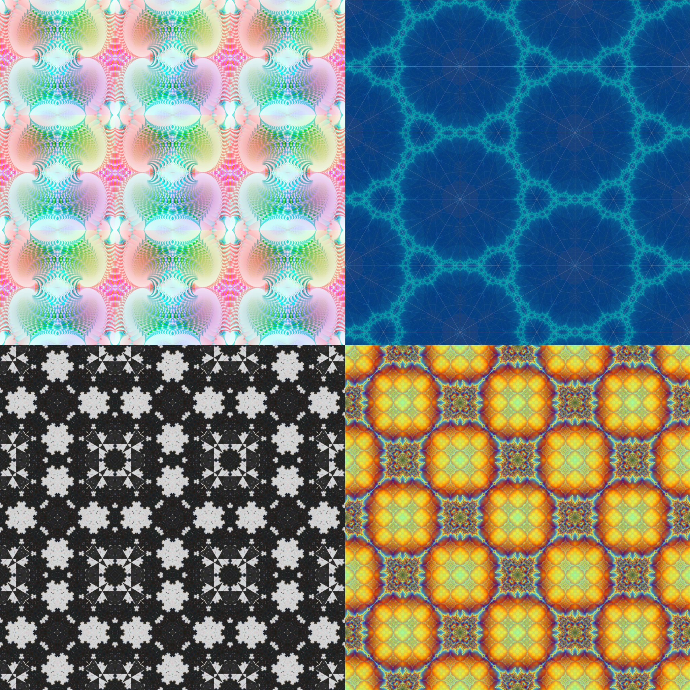

# Rosaic - Recursive mOSAIC

*Disclaimer: This was vibecoded with Claude.*

Rosaic is a video-feedback fractal tool built on the 17 wallpaper symmetry groups. An image is folded into a group's fundamental domain, tiled across the plane, and the result is fed back in as the next input. Repeated, this produces self-similar patterns that carry the symmetry of the chosen group at every scale.

It is a single HTML file with no build step and no dependencies (fonts load from Google Fonts if online). Open `index.html` in a browser.



## Try it

- **Here on GitHub Pages:** open the site for this repository.
- **As a Claude artifact:** https://claude.ai/artifact/LmzCG1adnWXobGnNghY4BB
  The ability to **Save PNG** and **Save Rosaic** don't work there - the artifact viewer blocks downloads for people outside the owner's organization. Everything else works. To save images, use the GitHub version or a downloaded copy.

## Features

- All 17 wallpaper groups (square/rectangular and hexagonal lattices), with orbifold signatures.
- An affine feedback frame you drag, rotate, scale and shear directly on the Source panel.
- Colour symmetries: hue cycle, colour reversal, group-word address map, rotation coset and orientation colourings, with optional centre falloff of the tint.
- Up to four layers, either **stacked** (each with its own feedback, coupled by an adjustable amount) or **composed** into one pipeline (A → B → …).
- Frame animation, per-layer rotation and scale, keep-alive controls against wash-out.
- Output resolution up to 2048 px, PNG export, and a **Save Rosaic** button that writes a standalone copy of the tool.
- The full setup can be copied as a text string and applied again later or shared.

Hover the **?** next to each control for an explanation.

## Getting started with an example

1. Paste this into the text box under **State & export** and press **Apply**:

   ```json
   {"v":2,"N":3,"sg":0,"vv":0.1,"bm":"blend","k":0,"cmb":"compose","res":756,"tf":true,"active":0,"layers":[{"g":"cmm","o":[0.341,0.503],"u":[0.1319,-0.182],"v":[0.091,0.0659],"cm":"rotcoset","wa":0.35,"b":true,"ba":0.9,"am":"off","as":0.5,"rot":0,"scl":1,"on":true,"op":0.5}]}
   ```

2. Press **Play** (or **Step** to go one iteration at a time).

## "Psychedelic" example

An example with two layers to produce flashy alternating colors (epilepsy warning).

   ```json
  {"v":2,"N":3,"sg":0,"vv":0.2,"bm":"blend","k":0,"cmb":"compose","res":756,"tf":true,"active":1,"layers":[{"g":"pgg","o":[0.5143,0.5782],"u":[-0.1225,0.0862],"v":[-0.0862,-0.1225],"cm":"invert","wa":0.4,"b":false,"ba":0.45,"am":"off","as":0.5,"rot":0,"scl":1,"on":true,"op":0.5},{"g":"pmm","o":[0.7223,0.4766],"u":[-0.1689,0.1057],"v":[-0.1057,-0.1689],"cm":"word","wa":0.4,"b":false,"ba":0.45,"am":"off","as":0.5,"rot":0,"scl":1,"on":true,"op":0.49}]}
   ```

## Note

With **Play** running, the colour modes can flash. Pause if that's uncomfortable.

## License

[GNU Affero General Public License v3.0](https://choosealicense.com/licenses/agpl-3.0/) or later.
